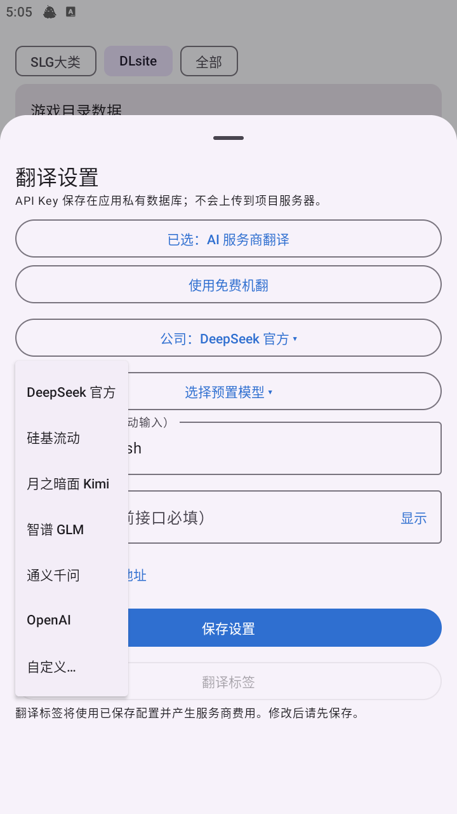

# 黄油之王

面向 **18 周岁以上用户**的游戏目录、个人游戏管理与社区。找作品、按标签筛选、阅读公开评论，也可以整理自己已有的游戏。

| 平台 | 用途 | 入口 |
| --- | --- | --- |
| Windows | 目录检索、本地游戏库、扫描匹配与启动程序管理 | [下载发布页中的 `slgking.exe`](https://github.com/JXZ666/slgking/releases/latest) |
| 网页 | 手机或电脑浏览器检索目录、查看评论、参与论坛和使用云端账号 | [直接打开](https://slg-king.com/m/#/) |
| Android | 手机浏览目录、评分收藏、追踪更新与 AI 翻译 | [在发布页下载 APK（测试版）](https://github.com/JXZ666/slgking/releases/latest) |

[官网](https://slg-king.com/) · [全部发行记录](https://github.com/JXZ666/slgking/releases) · [问题反馈](https://github.com/JXZ666/slgking/issues)

> 本项目只整理游戏资料，不托管游戏文件，也不提供游戏下载。请通过作品作者或发行方的渠道获取游戏。下载版号和具体更新以公开发行页为准。

## 找游戏与整理游戏

- 浏览 SLG 大类、DLsite 或全部目录，按名称、标签和来源检索；DLsite 还支持 RJ 编号、开发者、语言与作品形式。未知资料保持未知，原生评分与站内评分分别展示。
- Windows 可以扫描多个本地路径，自动寻找合集中的游戏根目录，核对候选、选择启动程序，也能手动添加作品、修复路径和更换封面。扫描不会执行游戏或脚本；联网匹配需主动查询并确认。
- Windows 和 Android 保留本机评分、想玩、收藏夹与个人记录。Android 的「追踪」分为版本更新、想玩、收藏夹；AI 翻译可先选公司和模型，再填入自己的 API Key，也保留免费翻译入口。
- 网页提供分页目录、积分榜和装扮榜。三端可阅读公开评论并使用共同的云端账号；论坛与游戏评论分别组织。

目录资料来自 [Dikgames](https://dikgames.com/)、[F95](https://f95zone.to.it/) 和 [DLsite](https://www.dlsite.com/)，由项目服务器整理后供三端读取。DLsite 目前仅收录部分作品，更新受来源规则、访问限制和采集预算影响；已有目录不代表全站覆盖。使用软件检索不会直接触发外站采集。

图：Android 翻译设置，选择公司和模型后填写自己的 API Key。

## 快速开始

1. Windows 下载 `slgking.exe`；Android 下载发行页唯一的官方 APK；网页直接打开链接。Android 需要 Android 7.0 及以上，包含 arm64 与 x86_64，不含 32 位 ARM。
2. 客户端选择目录后点击「更新游戏数据」。封面按需下载，缓存后的目录和资料可离线浏览；网页需要联网。
3. 到「个人」创建或登录账号，使用评分、收藏、签到、商城及公开评论。未登录仍可检索目录和阅读公开评论。
4. Windows 到「本地游戏库」核对扫描候选和启动程序；Android 到「追踪」管理想玩与收藏。PC 的扫描、游戏启动与存档工具不属于手机功能。

Android 仍是测试版。遇到问题请提供设备型号、Android 版本及复现步骤，提交截图前遮住账号密钥、API Key 和私人路径。

## 账号、私人资料与备份

三端共用云端账号、积分、装扮和公开评论。换设备请登录已有账号，不要重复创建新身份；妥善保存登录密钥和恢复码，项目无法通过邮箱重置账号。

**本机评分、收藏、游戏路径、私人记录和自建游戏不会随登录自动跨端同步。** Windows 数据保存在 `%LOCALAPPDATA%\slgking`，Android 数据在应用私有目录。网页「个人云记录」是单独的云端功能，仅本人登录后可见，不会与客户端本机私人记录自动合并。

升级前使用「备份与恢复」导出个人 JSON，并另存个人图片。JSON 不携带图片文件、Windows 本机私人评论或账号登录密钥与恢复码；导入可能覆盖原记录，请先备份目标设备。完整数据目录可能包含会话凭证和私人路径，应加密私存。正常覆盖升级保留原资料；Android 卸载重装会清除未备份的应用数据。

目录更新、封面、账号与评论功能需要网络。软件会发送随机安装标识、版本、平台及少量功能汇总统计，不上传本地游戏文件、私人评论正文或游戏路径。使用第三方 AI 翻译时，待翻译文本将发送到你配置的服务商；API Key 请自行保管，不要公开分享备份或设置截图。

## 反馈与许可

[GitHub Issues](https://github.com/JXZ666/slgking/issues) · QQ 交流群：1124074040。

感谢 **vegetable dog** 为 Android 移植作出的贡献。本项目采用 [GNU General Public License v3.0](LICENSE)。各端对应源码与校验和随发行提供；自动生成的标签源码以 Windows 发行基线为准，Android 与网页请使用各自的源码附件。

### English

黄油之王 is a game catalogue and personal library manager for adults aged 18+. Windows helps organize games already on your PC; the web app provides catalogue browsing and community features; Android is available as a test build. It does not host or distribute game files. Cloud accounts and public comments are shared, while local ratings, collections and private records do not automatically sync between devices. Get downloads and matching source archives from [Releases](https://github.com/JXZ666/slgking/releases/latest).
