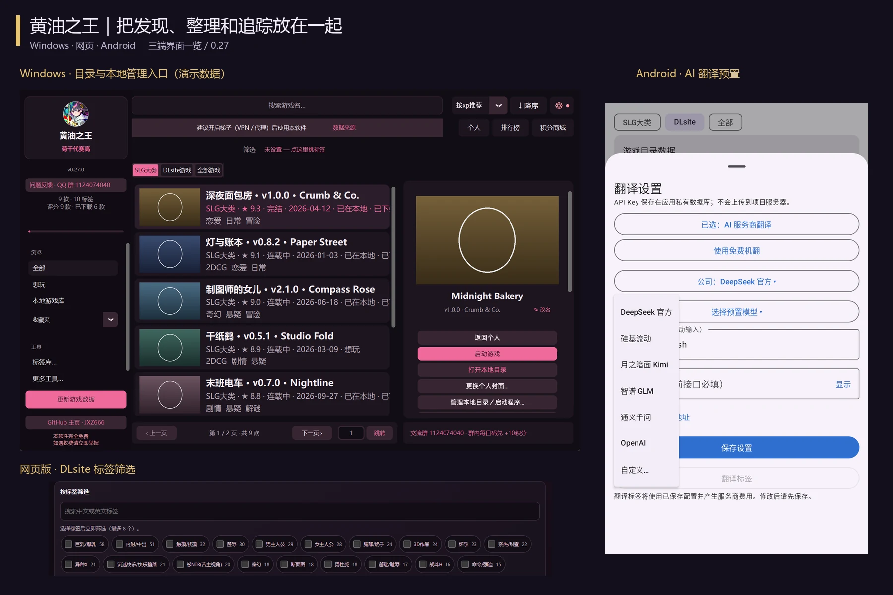
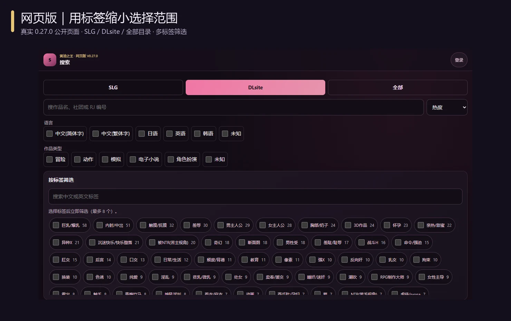
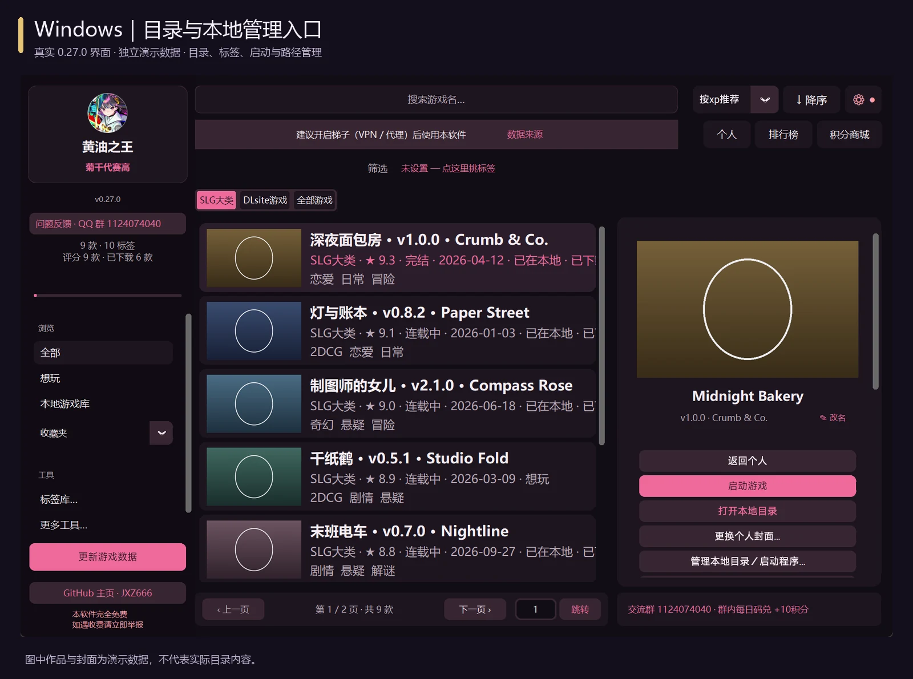

<h1>黄油之王</h1>

<strong>找下一款想玩的游戏，也整理电脑里已经拥有的游戏。</strong>

游戏目录 · 本地游戏库 · 更新追踪 · 玩家社区

<a href="https://github.com/JXZ666/slgking/releases/latest">Windows 下载</a> · <a href="https://slg-king.com/m/#/">打开网页版</a> · <a href="https://github.com/JXZ666/slgking/releases/latest">Android 测试版</a>

<a href="https://slg-king.com/">官网</a> · <a href="https://github.com/JXZ666/slgking/releases">发行记录</a> · <a href="https://github.com/JXZ666/slgking/issues">反馈问题</a>

黄油之王面向 **18 周岁以上用户**。你可以按标签找作品、阅读公开评论，把想玩的游戏收进清单；也可以在 Windows 上扫描已有的游戏文件夹，核对匹配结果，整理封面和启动程序。

> 本页展示 0.27 系列功能，实际可下载版本以公开发行页为准；Android 为测试版。项目只整理游戏资料，不托管或分发游戏文件，不提供游戏下载，请通过作者或发行方的渠道获取游戏。

## 从找游戏，到自己的游戏库

### 按题材找作品，少翻几页目录

切换 **SLG 大类、DLsite、全部目录**，按名称、来源和标签筛选。DLsite 目录还支持 RJ 编号、开发者、语言与作品形式检索，原生评分和站内评分分开展示。网页的分页、排序和筛选条件保存在链接中，从详情返回可以接着看。

网页版已上线，手机和电脑浏览器都能直接打开。除了目录检索，还可以阅读评论、参与论坛，查看积分榜与装扮榜。

### 游戏放在哪、该启动哪个，在本地库里理清楚

Windows 支持多路径扫描，也能在合集文件夹中自动寻找多款游戏的根目录。匹配时结合引擎线索、标题、编号和启动程序，逐款预览后再确认；遇到资料不足的作品，可以手动添加或主动联网查询。

- 核对候选与启动程序，减少卸载器、配置工具等辅助 EXE 的干扰。
- 修复移动后的游戏路径，自行选择或更换封面，保留人工修改。
- 扫描不执行游戏或脚本。联网查询由你发起，确认后才采用资料。
- 更换封面可选择本地图片、从剪贴板粘贴，或联网查找候选；预览确认后再保存。

### 想玩的、收藏的、等更新的，分别看

Android 的「追踪」分为 **版本更新／想玩／收藏夹**。更新可以逐条标为已读，切回详情后继续浏览；「我的记录」用于管理自己的记录、分类和网址。

阅读外文简介时，可以使用免费翻译，或选择自己的 AI 服务商。Android 预置 DeepSeek、硅基流动、Kimi、智谱 GLM、通义千问和 OpenAI 等选项，先选公司与模型，再填 API Key；自定义接口仍可手动设置。第三方服务的可用性、费用及隐私规则由相应服务商决定。

## 三端怎么选

| 你想做什么 | Windows | 网页 | Android |
| --- | --- | --- | --- |
| 按目录、来源与标签找作品 | 支持 | 支持，浏览器直接用 | 支持 |
| 扫描电脑游戏、匹配资料、管理启动程序 | 支持 | 不支持 | 不支持 |
| 管理本机评分、想玩、收藏及私人记录 | 支持 | 提供独立的个人云记录 | 支持 |
| 集中查看版本更新、想玩、收藏夹 | 支持相关管理功能 | 以目录和云端功能为主 | 「追踪」三分区 |
| 阅读公开评论、使用共同的云端账号 | 支持 | 支持 | 支持 |
| 离线查看已缓存目录和资料 | 支持 | 需要联网 | 支持 |

账号、积分、装扮和公开评论共用。**本机评分、收藏、路径、私人记录和自建游戏不会随登录自动跨端同步。** 网页的个人云记录仅本人登录后可见，与客户端本机记录分开保存。

## 三步开始

1. **选一个入口。** Windows 下载发行页中的 `slgking.exe`；Android 下载官方 APK；网页直接打开 [slg-king.com/m/](https://slg-king.com/m/#/)。Android 需要 7.0 及以上，支持 arm64 和 x86_64，不含 32 位 ARM。
2. **更新并浏览目录。** 客户端选择目录后点击「更新游戏数据」，封面按需下载；网页直接检索。未登录也能查目录、阅读公开评论。Windows 用户可进一步扫描本地库，先核对候选再保存。
3. **记下自己的进度。** 把感兴趣的作品加入想玩或收藏，使用评分和个人记录。需要签到、商城或发表评论时再创建或登录账号；换设备请使用已有账号。

## 升级、备份与资料边界

- 升级前从「备份与恢复」导出个人 JSON，并另存个人图片。Windows 替换 EXE、Android 正常覆盖安装会保留资料；Android 卸载重装会清除未备份的应用数据。
- JSON 不包含图片文件、Windows 本机私人评论、账号登录密钥或恢复码。导入可能覆盖已有记录，请先备份目标设备。完整数据目录可能包含会话凭证与私人路径，应加密私存。
- 妥善保存账号登录密钥和恢复码，项目无法通过邮箱重置账号。Windows 私人资料在 `%LOCALAPPDATA%\slgking`，Android 在应用私有目录。
- 目录更新、封面、账号与评论需要网络。软件会发送随机安装标识、版本、平台及少量功能汇总统计，不上传本地游戏文件、私人评论正文或游戏路径。
- 使用第三方 AI 翻译时，待翻译文本会发送给你配置的服务商。不要公开 API Key、账号密钥、恢复码或完整备份。

## 目录从哪里来

目录资料来自 [Dikgames](https://dikgames.com/)、[F95](https://f95zone.to.it/) 和 [DLsite](https://www.dlsite.com/)，经项目服务器整理为公开快照，再由三端读取。日常检索不会直接触发外站采集。

不同来源的资料完整度、更新速度和覆盖范围不同。DLsite 目前仅收录部分作品，更新受来源规则、访问限制与采集预算影响；不承诺全站收录或固定新增数量。缺失资料和未知标签不会被当成已核实内容，游戏更新仍请以作者或发行方说明为准。

## 反馈与参与

遇到问题，请到 [GitHub Issues](https://github.com/JXZ666/slgking/issues) 留下版本、平台、复现步骤和预期结果。Android 问题请补充设备型号与系统版本；截图中请遮住账号密钥、API Key、私人路径和备份内容。

QQ 交流群：**1124074040**。欢迎反馈目录错误、使用体验和可复现的 Bug。

感谢 **vegetable dog** 为 Android 移植作出的贡献，也感谢提交反馈和参与测试的玩家。

本项目采用 [GNU General Public License v3.0](LICENSE)。各端发行信息及对应源码入口请查看 [发行记录](https://github.com/JXZ666/slgking/releases)；游戏资料、封面和第三方服务的权利归各自权利人所有。

English

黄油之王 is a game catalogue and personal library manager for adults aged 18+. Browse and filter game information, organize games already on your Windows PC, or use the web and Android apps for browsing and personal records. Android is a test build. The project does not host or distribute game files.

Cloud accounts and public comments are shared. Local ratings, collections, paths and private records do not automatically sync between devices. Download builds from [Releases](https://github.com/JXZ666/slgking/releases/latest), or [open the web app](https://slg-king.com/m/#/).

